# 소규모 건설공사 설계 자동화 — 쇼룸

**[국토교통]** 읍면동 토목직이 직접 설계하는 소규모 건설공사(총공사비 3천만 원 이하)의
**야장 → 도면 → 수량산출서 → 설계내역** 과정을 자동화하는 도구입니다.
현업 지방공무원(토목직)이 AI 코딩 에이전트를 활용해 직접 개발하고 있으며, 실제 설계 건으로 검증하면서 범위를 넓히고 있습니다.
2026년 10월부터는 담당자가 평소 보던 서류 모양(수량산출서·내역서·도면·야장) 그대로 한 화면에서 확인하고 고치는 쪽으로 맞추고 있습니다.

> 이 저장소는 **쇼룸**입니다. 어떻게 돌아가는지와 결과물의 모습만 보여 드립니다. 소스 코드·자료·테스트는 비공개 저장소에 있습니다.
> 아래 샘플은 모두 **가상 예제**(가상 마을·가상 단가)로 만든 결과물이며, 실제 공사명·지번·금액은 들어 있지 않습니다.

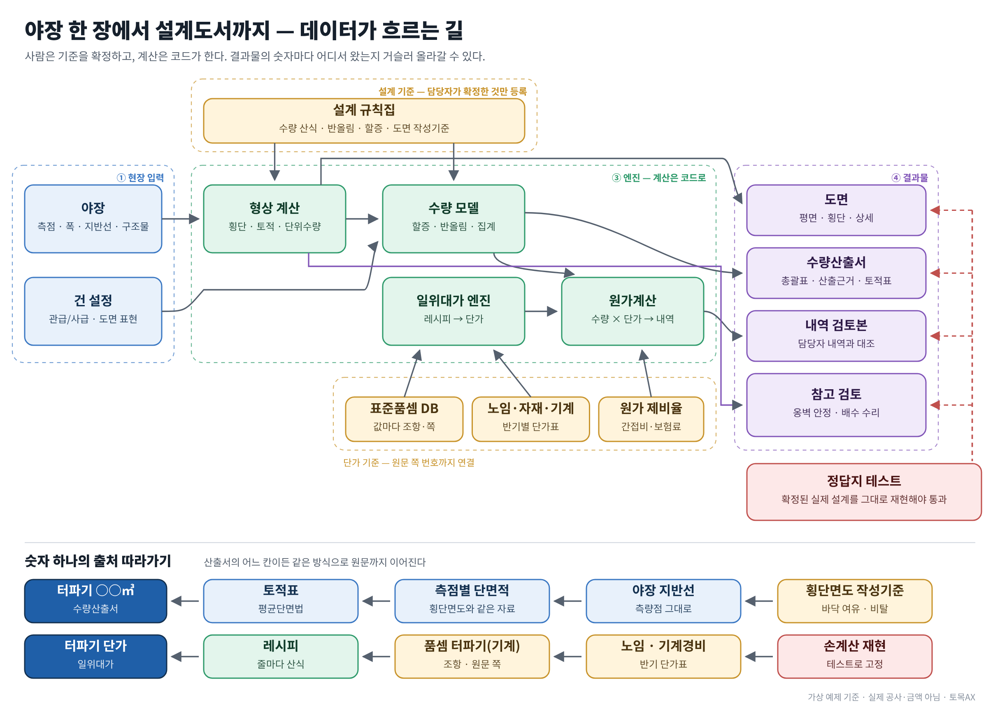

**사람은 기준을 확정하고, 계산은 코드가 한다.** 결과물의 숫자마다 어떤 규칙·입력에서 왔는지 거슬러 올라갈 수 있습니다.

## 시연 영상 (1분 38초)

<a href="video/demo.mp4">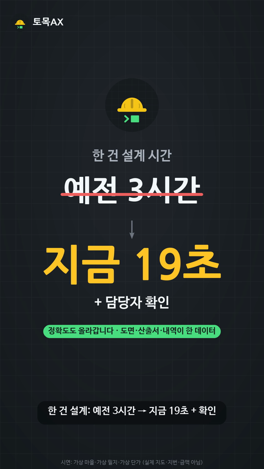</a>

야장 → 위치도·편입예상필지 조서 → 도면 → 수량산출서 → 내역서까지 한 흐름으로 보여 줍니다. **[▶ 영상 보기](video/demo.mp4)** (세로 9:16, 소리 있음)

영상 속 마을·필지·항공영상·단가는 가상이며, 금액은 보여 주지 않습니다.

## 왜 만들었나

읍면동 토목 담당자는 매년 수십 건의 소규모 공사를 자체 설계합니다. 현장 야장을 보고 도면을 그리고,
면적·자재·숭상 수량을 손으로 계산해 수량산출서를 만든 뒤 내역 프로그램에 옮겨 적는 과정이 모두 수작업이고,
읍면동마다 양식이 제각각입니다. 이 도구는 **야장만 표준 형식으로 적으면 도면·산출서가 나오도록** 해
반복 계산을 없애고, 같은 양식을 쓰게 하는 것을 목표로 합니다.

## 흐름

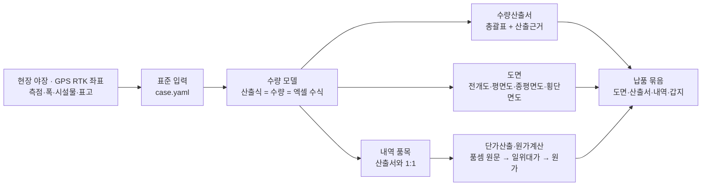

입력 한 번으로 도면·수량산출서·산출근거·납품 묶음까지 만듭니다. 계산은 결정론적 코드가 하고, AI는 규칙 정리·검토·문장 작성에만 씁니다.

## 2026년 10월에 더한 것

10월 12일 이후 비공개 저장소에 들어간 기능입니다. 샘플 그림은 아래 결과물에 들어간 것(배수로 종평면도 — 가상 GPS RTK 좌표)만 있고, 나머지는 글로만 적습니다.

- **서류 작업대** (구현) — 수량산출서는 엑셀 모양, 내역서는 내역 프로그램 모양, 도면·야장·건 폴더를 탭으로 넘겨 보며 확인합니다. 새 건 만들기부터 결과 파일까지 같은 화면 안에서 합니다.
- **말로 고치기** (구현) — "1공구 NO.9 폭 3.8m로 바꿔"처럼 말하면 고칠 목록을 만들고, 담당자가 보고 「적용」해야 다시 계산합니다. 애매한 말은 되묻고, 정답지·단가·계산 결과를 직접 바꾸는 말은 코드가 막습니다. 종단 계획선(관저고·경사·변곡점)도 말로 고칠 수 있고, "~해 줄래?" 같은 부탁도 고치기로 알아봅니다. 다시 그린 도면 쪽에는 '바뀜'을 표시합니다. 인터넷 없이 내 컴퓨터의 AI 모델로 채점합니다 — 131문항에서 GPT-OSS 20B가 97문항을 맞게 처리(고침·되묻기·막기)했고, 잘못 고친 것 0, 짐작해서 고친 것 0이며, 나머지는 되묻거나 막아 사람에게 넘겼습니다(2026-10-25). 무엇이든 담당자가 「적용」하기 전에는 들어가지 않습니다.
- **GPS RTK 좌표 → 종평면도** (구현) — RTK 장비가 내보낸 좌표 파일(점번호·X·Y·Z)을 넣으면 위에 평면, 아래에 종단(지반고)을 그린 종평면도가 나옵니다. 종단 계획선을 정하면 측점마다 터파기 깊이가 횡단면도·토적계산서로 이어집니다.
- **지난 건 양식 가져오기** (구현) — 지난 설계 건의 도면 표제란 문구, 내역 품목 순서, 산출서 머리 문구를 새 건에 그대로 씁니다.
- **업체 설계도서 교차 검사** (구현) — 업체가 낸 도면·수량산출서·내역서의 수량이 서로 맞는지 근거추적표로 보고, 검토 결과 보고서(한글 hwpx, A4 한 쪽)를 만듭니다.
- **공사시방서·설계설명서** (구현) — 건설공사 표준시방서(KCS) 대응표로 공사시방서와 설계설명서 초안을 만듭니다.
- **설계변경 서류** (시제품) — 당초·변경 야장을 비교해 공사비 증감 대비표·물량 대비표(xlsx)와 변경사유서(hwpx)를 만듭니다. 비목 증감 합이 총공사비 차이와 원 단위로 맞지 않으면 멈춥니다.
- **출장복명서·현장사진 위치도** (시제품) — 건 폴더의 현장사진으로 위치도에 번호 핀과 사진 썸네일을 붙이고, 출장복명서 초안(hwpx)을 만듭니다.
- **예산서 읽기** (시제품) — 세출예산서(xlsx·csv·웹 저장 엑셀 등)를 읽어 담당 시설사업 목록을 만듭니다.
- **유역 참고 계산** (시제품) — 수치지형도 등고선으로 유역면적·평균 경사를 구해 배수 수리계산의 참고값으로 씁니다. 담당자 확인 표시가 있어야 계산에 들어갑니다.

'시제품'은 가상 예제와 시험으로 확인했고, 실제 건에 쓰기 전에 담당자 양식으로 맞추는 중인 것입니다. 지도·좌표·사진은 이 쇼룸에 싣지 않습니다.

## 결과물 샘플 (가상 예제)

<a href="samples/demo04_drainage/drawing_location.png">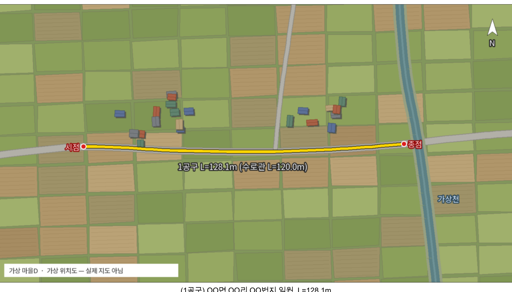</a> <a href="samples/demo04_drainage/drawing_plan.png">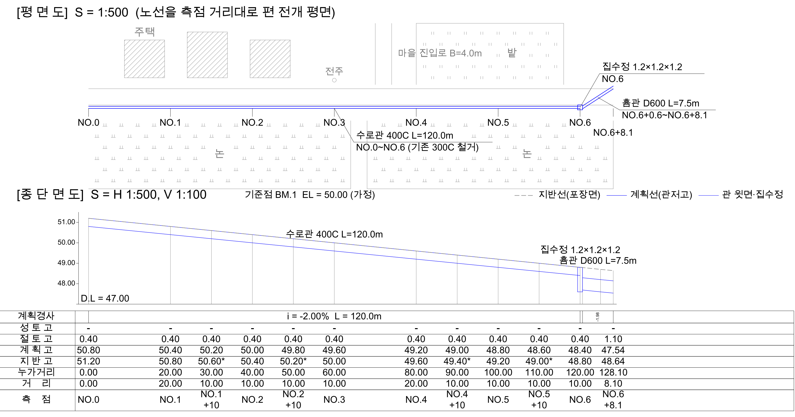</a>

왼쪽: 위치도(가상 마을 그림 — 실제 지도 아님) · 오른쪽: 배수로 종평면도 — 위는 평면(1:500, 노선을 측점 거리대로 편 그림), 아래는 가상 GPS RTK 좌표의 높이로 그린 종단(지반선·계획선 i=-2.00%)과 측점별 표. 주변 현황(논·밭·주택·진입로·전주)은 회색 배경. 그림을 누르면 도곽 한 장 전체

| 공종 | 대표 화면 (누르면 도곽 한 장) | 도면 · 수량산출서 | 더 보기 |
|---|---|---|---|
| **아스콘 덧씌우기** 확포장·숭상·접속 | <a href="samples/demo01_asphalt/drawing_strip.png">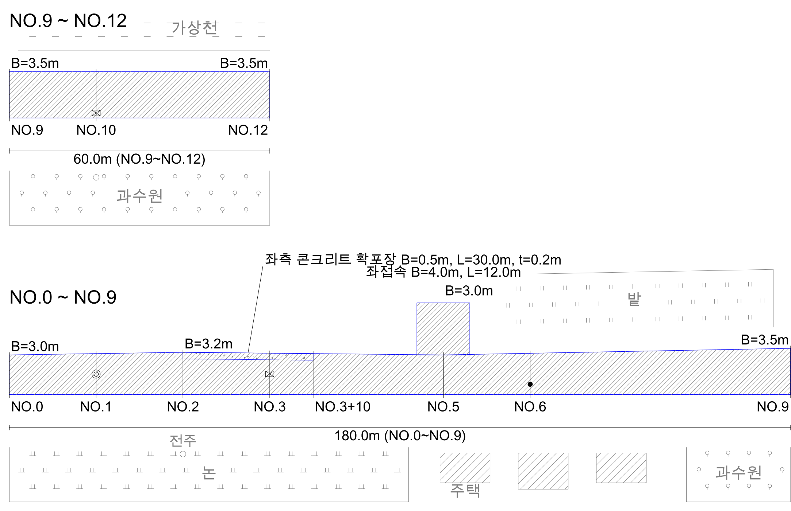</a> | demo01 [도면](samples/demo01_asphalt/drawing.pdf) · [산출서](samples/demo01_asphalt/sheet.pdf) demo02 [도면](samples/demo02_asphalt_standard/drawing.pdf) · [산출서](samples/demo02_asphalt_standard/sheet.pdf) | [위치도](samples/demo01_asphalt/drawing_location.png) · [전개도(폭 급변)](samples/demo02_asphalt_standard/drawing_strip.png) · [총괄표](samples/demo01_asphalt/sheet_summary.png) · [산출근거](samples/demo01_asphalt/sheet_basis.png) |
| **콘크리트 깨기및복구** 줄눈·컷팅·앙카 | <a href="samples/demo03_concrete/drawing_plan.png">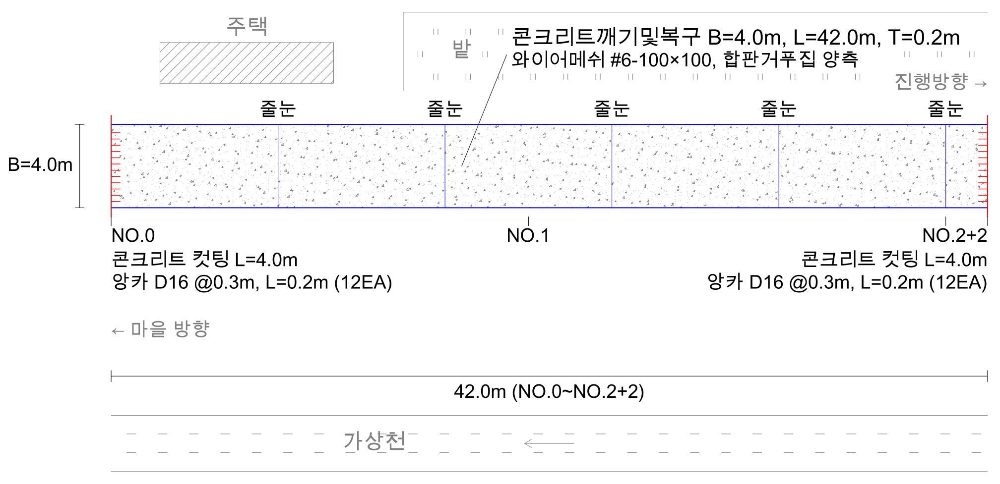</a> | [도면](samples/demo03_concrete/drawing.pdf) · [산출서](samples/demo03_concrete/sheet.pdf) | [횡단면도](samples/demo03_concrete/drawing_section.png) · [총괄표](samples/demo03_concrete/sheet_summary.png) · [산출근거](samples/demo03_concrete/sheet_basis.png) |
| **배수로** 횡단 · 토적 · 수리 | <a href="samples/demo04_drainage/drawing_section.png">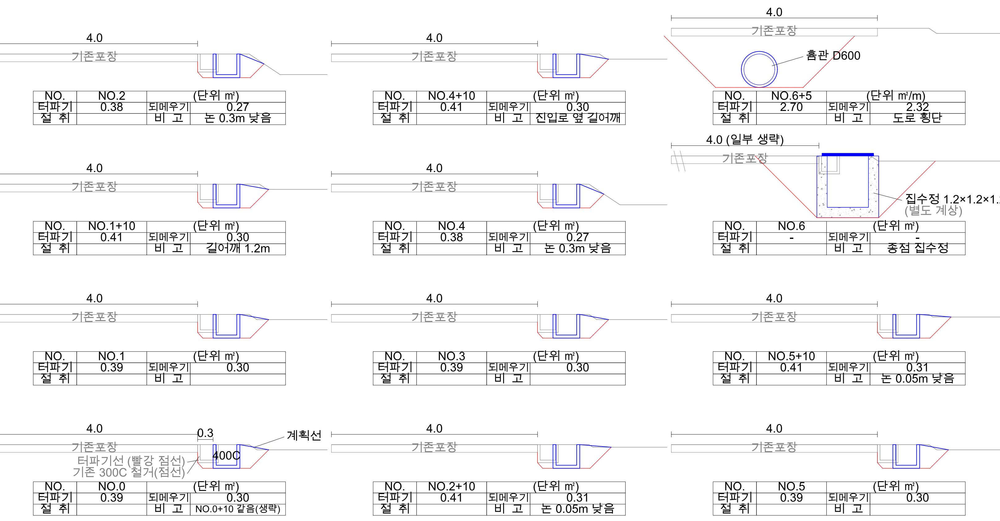</a> | [도면](samples/demo04_drainage/drawing.pdf) · [산출서](samples/demo04_drainage/sheet.pdf) | [종평면도](samples/demo04_drainage/drawing_plan.png) · [위치도](samples/demo04_drainage/drawing_location.png) · [토적계산서](samples/demo04_drainage/sheet_earthwork.png) · [수리계산(참고)](samples/demo04_drainage/sheet_hydraulics.png) · [총괄표](samples/demo04_drainage/sheet_summary.png) |
| **식생블럭 호안** 횡단 · 안정검토 φ30에서 활동 1.31 &lt; 1.5 → 검토 시트가 담당자에게 경고(단면은 자동으로 바꾸지 않음) | <a href="samples/demo05_revetment/drawing_section.png">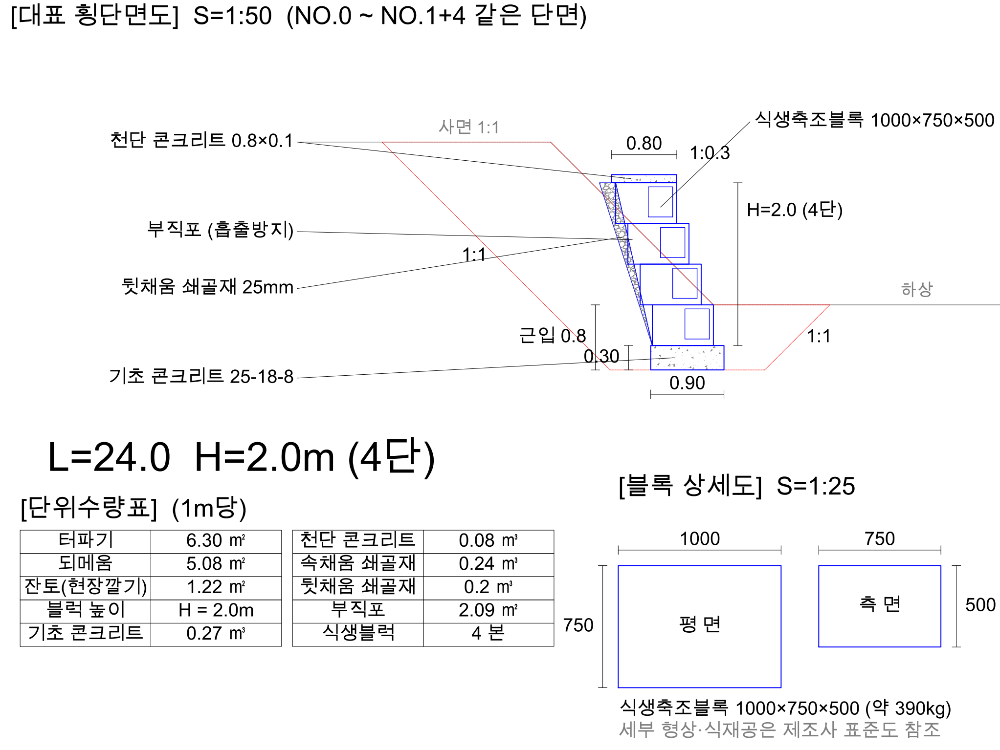</a> | [도면](samples/demo05_revetment/drawing.pdf) · [산출서](samples/demo05_revetment/sheet.pdf) | [평면도·정면도](samples/demo05_revetment/drawing_plan.png) · [안정검토(참고)](samples/demo05_revetment/sheet_stability.png) · [총괄표](samples/demo05_revetment/sheet_summary.png) · [산출근거](samples/demo05_revetment/sheet_basis.png) |

- 배수로는 측점마다 지반선·터파기선·계획선을 그린 횡단면도(1:50, 한 장 3열×4단)와 같은 자료로 평균단면법 토적계산서를 만듭니다.
- 평면도의 주변 현황(논·밭·주택·하천·진입로 등)은 선택 입력이며, 설계 글자와 겹치지 않게 회색 배경으로만 그립니다.
- 안정검토·수리계산은 **검토용 참고 — 결과로 단면·규격을 바꾸지 않습니다**(기준 미달이면 경고와 추천만, 판단은 설계자).

### 위치도 · 편입예상필지 조서 (위치도도구)

<a href="samples/location_tool/location_map.png">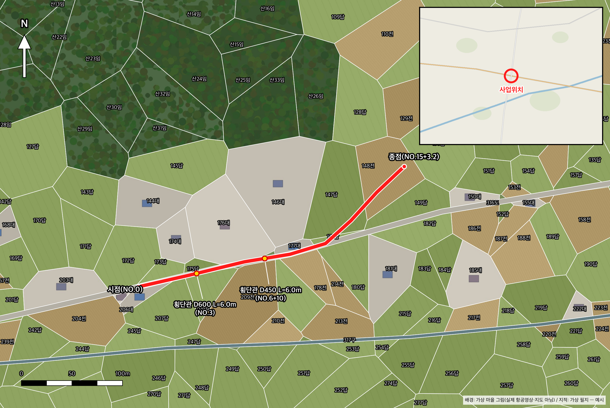</a> <a href="samples/location_tool/land_map.png">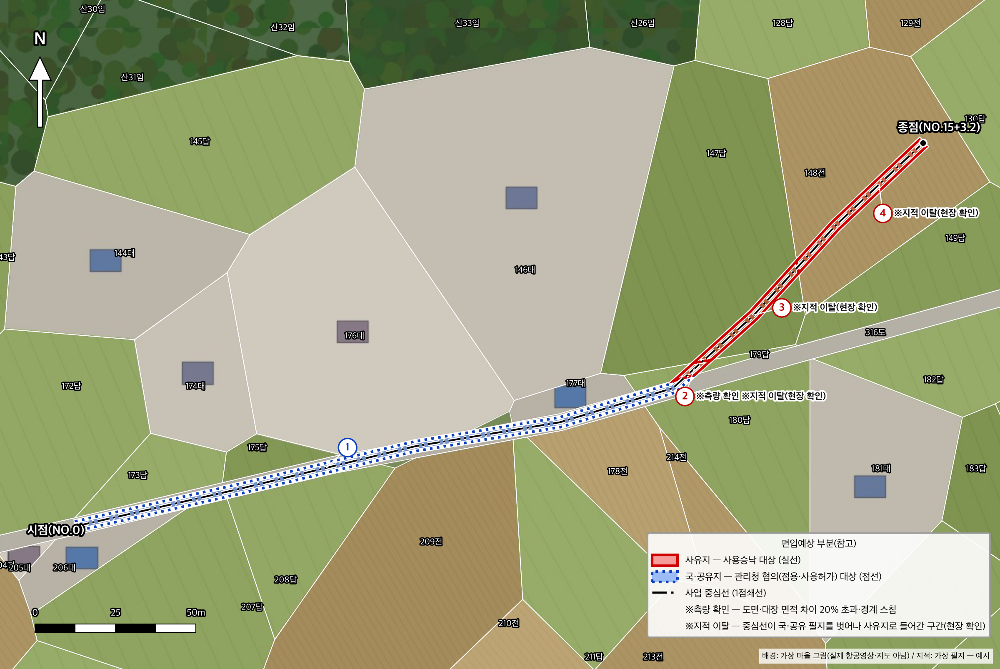</a>

왼쪽: 위치도 · 오른쪽: 편입용지도 — 샘플은 **가상 마을 그림과 가상 필지**로 만들었습니다(실제 항공영상·지도·지적·소유정보 아님). 조서: [PDF](samples/location_tool/sheet.pdf) · [그림](samples/location_tool/sheet_table.png)

- 현장에서 시점·종점·관 위치를 휴대폰으로 찍어 두면, 사진 위치정보로 지도에 점이 놓이고 항공영상 위에서 노선을 다듬습니다. GPS 측량 좌표 파일(위도·경도, 측량 원점 좌표)도 그대로 읽습니다.
- 버튼 한 번으로 위치도(도면 위치도 칸에 맞춘 그림)와 편입예상필지 조서·편입용지도를 만듭니다. 측점만 적은 시설물(횡단관 등)은 설계연장 비례로 노선 위에 놓습니다.
- 조서 비고는 규칙으로 자동: 국·공유지는 관리청 협의, 도면·대장 면적 차이가 크면 측량 확인, 노선이 공공 필지를 벗어나 사유지로 들어가면 지적 이탈(현장 확인).
- 연속지적도 기반 **참고용(법적 효력 없음)** — 면적은 '편입예상면적(참고)', 보상·분할은 지적측량 성과에 따릅니다. 토지 소유자 성명·주소는 조회하지도 저장하지도 않습니다.

### 용역 내역서 검토 (검토의견표)

<a href="samples/est_review/sheet_summary.png">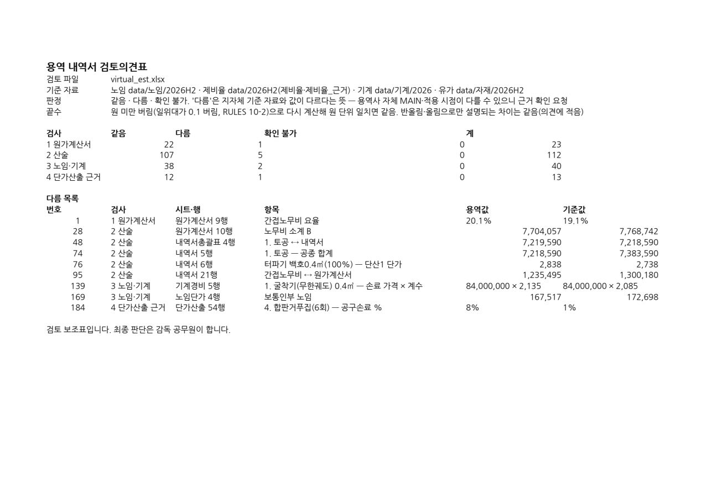</a> <a href="samples/est_review/sheet_table.png">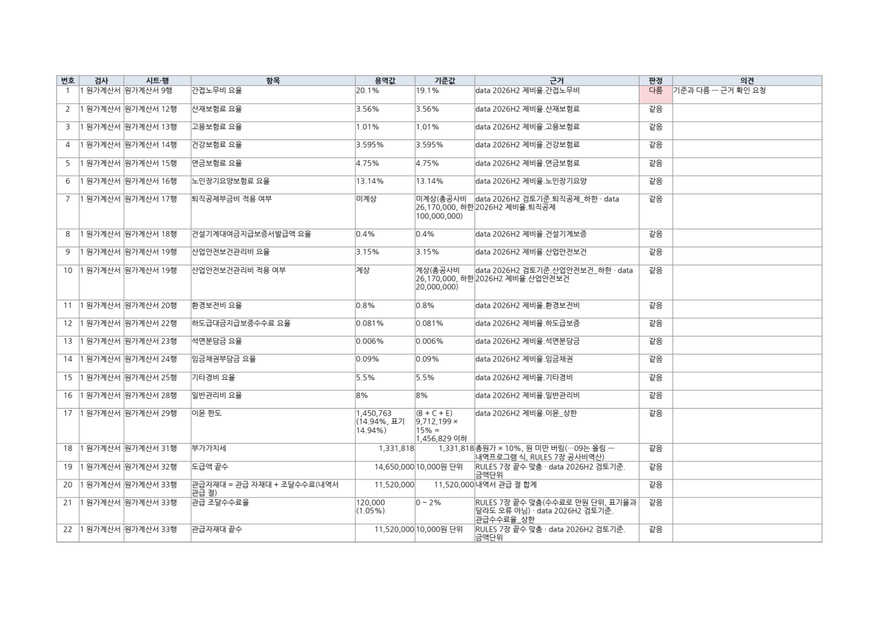</a>

가상 공사의 내역서에 오류 5가지(옛 노임·제비율·총괄표 합계·단가 참조·기계 손료 계수)를 심어 검토한 결과입니다. 검토의견표: [PDF](samples/est_review/sheet.pdf)

- 용역사가 내역 프로그램으로 납품한 내역서(엑셀 변환 파일)를 넣으면 검토의견표(xlsx)가 나옵니다. 감독 공무원의 검토 보조표이고, 최종 판단은 사람이 합니다.
- 검사 ① 원가계산서: 제비율 요율·적용 여부, 이윤 한도, 부가세, 폐기물처리비 위치, 관급 조달수수료, 끝수 ② 산술: 단가 × 수량, 공종 합계, 총괄표 ↔ 내역서, 일위대가·단가산출 참조 단가 ③ 노임·기계경비: 공표 노임, 품셈 기계경비 기초값으로 다시 계산해 대조.
- 판정은 '같음 · 다름 · 확인 불가'만 씁니다. '다름'은 기준과 값이 다르니 근거를 확인해 달라는 뜻이고, 틀렸다고 단정하지 않습니다(용역사 기준·적용 시점이 다를 수 있음). 끝수 방식 차이(반올림·버림)는 같음으로 두고 의견에 적습니다.
- 실제 용역 성과품은 기관 컴퓨터의 코드로만 검토하고 외부 AI로 보내지 않습니다.

**수량산출근거** — 품목마다 산출식(기호=값+단위)과 수량, 공구 → 공통 → 전체 집계(할증·올림·정수)

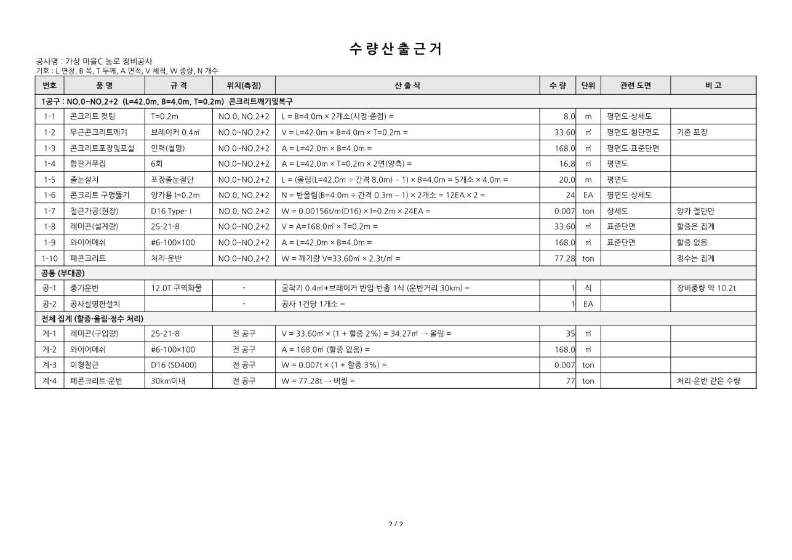

## 시연 영상

시연 영상은 스레드에서: https://www.threads.com/@civil__ax

## 지원 공종

| 공종·기능 | 내용 | 상태 |
|---|---|---|
| 아스콘 덧씌우기 | 본선·접속 면적, 아스콘·유제(할증, 관급 구입량 올림), 노면청소·텍코팅, 차선도색(접속부 규칙) | 실제 3건 검증 |
| 숭상(맨홀·집수정·지수전·그레이팅 인상) | 깨기·재타설 방식, 내역 품목(맨홀인상 규격)별 개소, 폐콘 참고 집계 | 실제 3건 검증 |
| 콘크리트 확포장 | 면적·레미콘·거푸집(편측/양측)·앙카(구멍뚫기·철근) | 실제 2건 검증 |
| 콘크리트 깨기및복구 | 컷팅·깨기·포장·거푸집·줄눈(최대 간격)·앙카(접속단부)·와이어메쉬·폐기물, 평면도·횡단면도 | 실제 1건 검증 |
| 배수로(수로관·흄관 교체) | 측점별 횡단면도(지반선·터파기선·계획선)·평균단면법 토적, 흄관 매설·집수정 토공, 관 본수·이음 | 실제 1건 수량 계산과 대조 |
| 식생블럭 호안 | 단면(블럭 단·기초·천단·뒷채움)·토공·호안공·부대공, 블럭 할증, 평면도·정면도·횡단면도·상세도 | 실제 1건 검증 |
| 중력식 옹벽 | 관행형 단면·토공·거푸집·배면배수, 같은 레이아웃의 도면 | 실제 1건 단면 계산과 대조 |
| 참고 검토 | 옹벽·식생블럭 간이 안정검토(활동·전도·편심), 배수 수리계산(합리식·Manning, 최소구배 구간) — 검토용 참고 | 참고 계산 재현 |
| 수량산출서 | 수량총괄표 + 수량산출근거, 내역 품목과 1:1, 산출식·수량·엑셀 수식이 같은 식 데이터, 설계변경 당초/변경 두 줄, 토적계산서·참고 시트 | 실제 5건 납품 수량과 대조 |
| 단가산출(일위대가) | 품셈 원문 대조값·노임·자재·기계 기초값 → 노무·재료·경비 원 단위, 내역서 금액 | 실제 일위대가 12개 원 단위 일치 |
| 원가계산 | 제비율·절사, 원가계산서 양식 선택, 폐기물처리비 위치, 공사비역산(이윤율·조달수수료 끝수), 수의계약 계약내역 | 실제 5건 원 단위 일치 |
| 도면 | 전개도·평면도·종평면도(GPS RTK 좌표 → 평면 + 종단)·횡단면도(횡단형 3열×4단)·호안 평면·정면도, NOTE·범례·라벨 자리 자동, 실제 축척 표기, 설계변경 표시, 위치도(항공뷰 도로선 따라 노선), 평면도 주변 현황(회색 배경, 선택) | 실제 4건 납품 도면 대조 |
| 용역 내역서 검토 | 원가계산서(제비율·적용 여부·이윤 한도·부가세·폐기물 위치·조달수수료·끝수)·산술(단가×수량·공종 합계·총괄표·참조 단가)·노임·기계경비 대조 → 검토의견표(같음·다름·확인 불가) | 실제 확정 내역 5건(알려진 차이만)·용역 납품 5건 산술 대조 |
| 납품 묶음 | 도면 DXF+PDF, 위치도 그림 이름 검사, 산출서, 내역, 갑지 | 실제 납품 구성 기준 |
| 배수 구조물 | 수로관·옹벽식측구·식생블럭·옹벽 단위수량과 산출서 양식 | 1단계 완료 |

## 검증 방식

- **실제 확정 설계와 원 단위 대조**: 실제 확정 6건의 수량·내역·원가를 내역 프로그램 확정본과 원 단위로, 도면·산출서를 납품본과 글자 단위로 대조합니다. 비공개 저장소의 자동 검사는 모두 **1,334개**입니다(2026-10-25 기준, 기능 시험 포함).
- **가상 예제 회귀**: 같은 코드를 가상 예제 5건과 가상 단가로 돌리는 테스트 **364개**. 가상 예제의 기대수량은 규칙 식으로 손계산한 값이고, 이 쇼룸의 샘플은 그 가상 예제의 결과물입니다.
- **근거 우선순위**: 표준품셈 원문(조항·쪽 번호 대조) → 발주기관 설계기준 → 과거 설계(내역 프로그램 관행). 품셈에 없는 관행값은 '근거 미확인'으로 표시해 둡니다.
- **처리 시간**: 야장 입력부터 설계도서 묶음(도면·산출서·내역서·시방서·zip)까지 엔진 시간은 한 건 6~8초입니다(실제 확정 5건, 2026-10-25 실측). 사람이 확인하는 시간은 들어 있지 않습니다.
- **공개 검사**: 쇼룸에 올리기 전에 금지어(실제 마을명·지번·연락처 등)와 숫자 대조(실제 정답지·실제 단가 숫자), 이용 조건, 결과물 메타데이터를 자동으로 검사합니다.

## 규칙

현장에서 확인한 설계 규칙의 목차는 [docs/규칙_목차.md](docs/규칙_목차.md)에 있습니다(상세 규칙은 비공개).

## 로드맵

| 순서 | 공종 | 상태 |
|---|---|---|
| 1 | 아스콘 덧씌우기 + 숭상 | 실제 3건으로 검증 |
| 2 | 콘크리트 확포장 | 실제 2건으로 검증 |
| 3 | 콘크리트 깨기및복구(농로 재포장) | 실제 1건으로 검증 |
| 4 | 수로관·흄관 매설(배수로 횡단형) | 구현 — 실제 1건 수량 대조, 확정 설계 등록 대기 |
| 5 | 식생블럭 호안·중력식 옹벽 | 식생블럭 실제 1건으로 검증, 옹벽 구현(확정 설계 등록 대기) |

## 참고

- 노임·제비율은 공표값, 샘플의 자재 단가·일위대가는 **가상값**입니다.
- 다른 지자체에서 사용을 원하시면 아래 이용 조건에 따라 신청해 주세요.

## 이용 조건

이 저장소는 오픈소스가 아닙니다. **열람은 공개, 사용은 허락제**입니다(전문은 [LICENSE](LICENSE)).

- 코드·문서·자료는 열람과 학습 목적의 읽기만 허용합니다. 설치·실행·복제·수정·배포·상업적 이용은 공공기관을 포함한 모든 이용자가 저작권자의 사전 서면 허락을 받아야 합니다.
- 공공기관(국가·지방자치단체·공공기관)의 비영리 업무 이용은 신청 시 무상으로 허락합니다.
- 업체의 판매·납품·용역 등 상업적 이용은 별도 협의가 필요합니다.

이용 신청·문의: https://open.kakao.com/me/tomokax — 신청하실 때 **기관명·담당 부서·이용 목적**을 알려 주세요.
